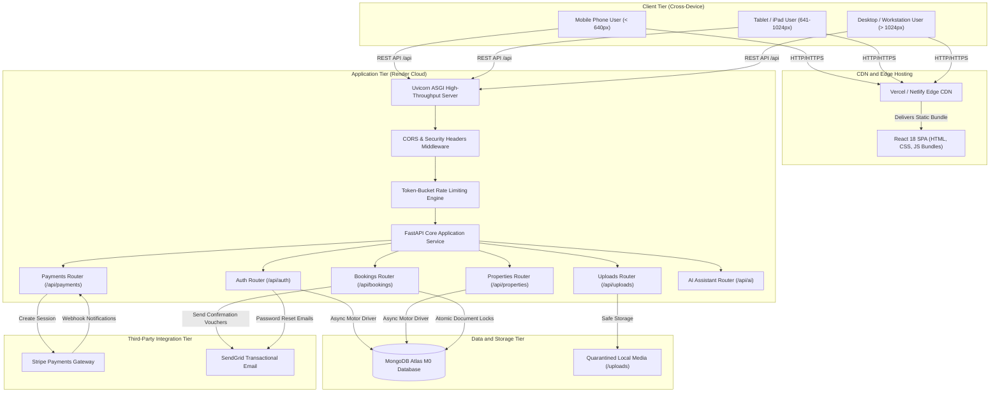
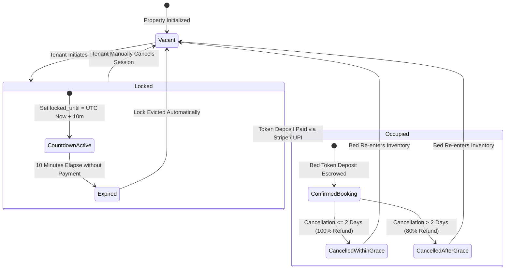
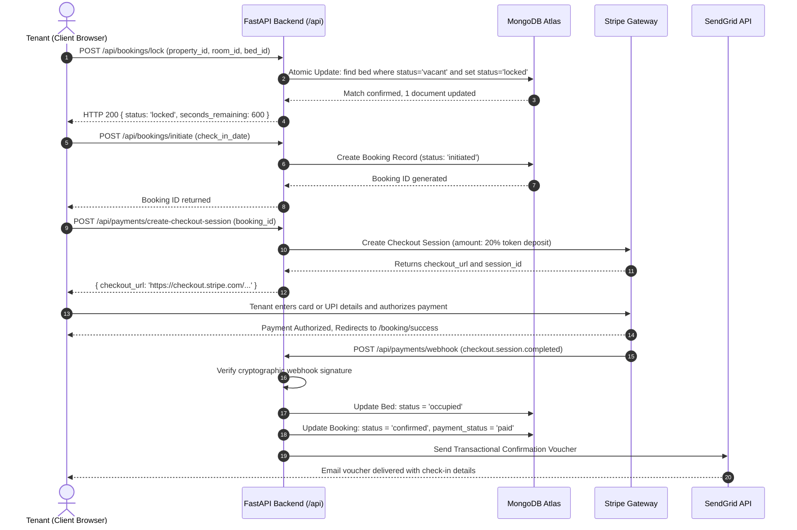
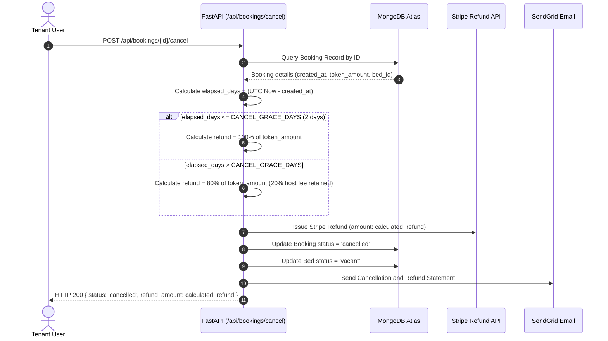

# System Architecture and Technical Blueprints

## Project: NextGen PG and Co-Living Booking Platform
**Architecture Type:** Asynchronous Micro-Web Architecture and Enterprise Reference  
**Date:** October 2026  

---

## 1. High-Level System Architecture (C4 Container View)

---

## 2. Bed Reservation State Machine

---

## 3. End-to-End Payment and Booking Sequence Flow

---

## 4. Cancellation and Refund Algorithm Sequence

---

## 5. Architectural Quality Attributes

1. Reliability:
   - Database operations wrapped in defensive try/except blocks with graceful in-memory store fallbacks.
   - Idempotent Stripe webhook handling preventing duplicate credit records.

2. Scalability:
   - Stateless web workers capable of scaling horizontally across container clusters.
   - Static assets cached at global edge CDNs (Vercel/Netlify) with zero backend CPU consumption.

3. Security:
   - End-to-end token validation with HS256 HMAC cryptographic signing.
   - Zero hardcoded secrets; 100 percent dynamic environment variable binding.
   - Comprehensive input sanitization against ReDoS, SQLi, and NoSQL injection.
