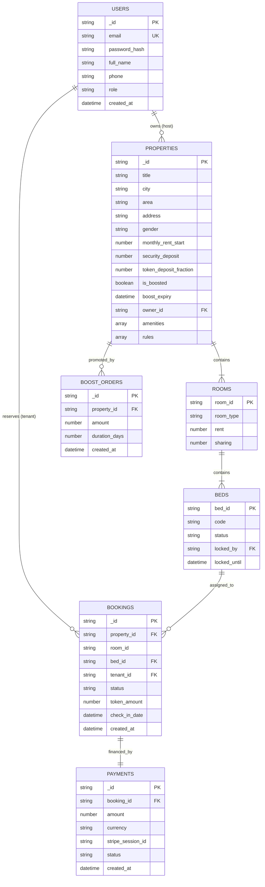

# Database Design and Schema Specification

## Project: NextGen PG and Co-Living Booking Platform
**Databases Documented:** MongoDB Atlas (Production Web Store) & PostgreSQL 16 (Enterprise Schema)  
**Date:** October 2026  

---

## 1. Entity Relationship Overview



---

## 2. Production MongoDB Collection Specifications

### 2.1 Collection: `users`
Stores authenticated tenant and property owner credentials.

```json
{
  "_id": "user-demo-tenant",
  "email": "student@example.com",
  "password_hash": "$2b$12$52izrd/wnMBx2PyeoqME0e4pYOLzzHTAgU/1St7tGmw8Nb6SSC3F2",
  "full_name": "Aman Verma",
  "phone": "+91 98765 43210",
  "role": "tenant",
  "created_at": "2026-10-13T12:00:00Z"
}
```

- Primary Key: `_id` (String UUID)
- Unique Index: `{ "email": 1 }` (unique=True)
- Role Enum: `"tenant"`, `"owner"`, `"admin"`

---

### 2.2 Collection: `properties`
Stores accommodation listings with nested Room and Bed structures.

```json
{
  "_id": "prop-jai-01",
  "title": "Stanza Living & Student Hub Malviya",
  "city": "jaipur",
  "area": "Malviya Nagar / Near MNIT",
  "address": "B-42, Siddharth Nagar, Malviya Nagar, Jaipur, Rajasthan 302017",
  "gender": "male",
  "description": "Premium student PG located 5 minutes from MNIT Jaipur campus...",
  "monthly_rent_start": 6500,
  "security_deposit": 7000,
  "token_deposit_fraction": 0.2,
  "is_boosted": true,
  "boost_expiry": "2027-01-01T00:00:00Z",
  "rating": 4.9,
  "reviews_count": 52,
  "amenities": ["High-Speed Wi-Fi", "3 Hygienic Meals", "Power Backup", "Air Cooler / AC", "RO Water"],
  "cover_image": "https://images.unsplash.com/photo-1555854877-bab0e564b8d5",
  "images": [
    "https://images.unsplash.com/photo-1555854877-bab0e564b8d5",
    "https://images.unsplash.com/photo-1522771739844-6a9f6d5f14af"
  ],
  "owner_id": "user-demo-owner",
  "owner_name": "Manoj Kumar",
  "owner_phone": "+91 98290 12345",
  "owner_email": "manoj.portfolio.website@gmail.com",
  "rooms": [
    {
      "room_id": "room-101",
      "room_type": "Double Sharing AC",
      "rent": 7500,
      "sharing": 2,
      "beds": [
        {
          "bed_id": "bed-101-A",
          "code": "101-A",
          "status": "vacant",
          "locked_by": null,
          "locked_until": null
        },
        {
          "bed_id": "bed-101-B",
          "code": "101-B",
          "status": "vacant",
          "locked_by": null,
          "locked_until": null
        }
      ]
    }
  ],
  "rules": ["Entry deadline: 10:00 PM", "No smoking", "ID verification required"],
  "created_at": "2026-10-13T12:00:00Z"
}
```

- Index 1: `{ "city": 1, "is_boosted": -1, "monthly_rent_start": 1 }` (Primary search index)
- Index 2: `{ "owner_id": 1 }` (Owner dashboard lookup)
- Index 3: `{ "rooms.beds.bed_id": 1 }` (Bed status querying)

---

### 2.3 Collection: `bookings`
Tracks tenant reservation lifecycle from lock initiation through payment or cancellation.

```json
{
  "_id": "book-9872134",
  "property_id": "prop-jai-01",
  "room_id": "room-101",
  "bed_id": "bed-101-A",
  "tenant_id": "user-demo-tenant",
  "tenant_name": "Aman Verma",
  "tenant_email": "student@example.com",
  "tenant_phone": "+91 98765 43210",
  "property_title": "Stanza Living & Student Hub Malviya",
  "monthly_rent": 7500,
  "token_amount": 1500,
  "check_in_date": "2026-11-01",
  "status": "confirmed",
  "payment_status": "paid",
  "payment_method": "stripe_card",
  "payment_id": "cs_test_a1b2c3d4",
  "created_at": "2026-10-14T01:00:00Z",
  "cancelled_at": null,
  "refund_amount": 0
}
```

- Index 1: `{ "tenant_id": 1, "created_at": -1 }` (Tenant history)
- Index 2: `{ "property_id": 1, "status": 1 }` (Host booking audit)
- Index 3: `{ "bed_id": 1, "status": 1 }` (Collision validation)

---

## 3. PostgreSQL 16 Enterprise Relational Schema Reference

For high-scale multi-region deployment, the `pgbooking/database/migrations` subsystem defines the equivalent normalized PostgreSQL schema:

1. `users`: UUID primary key, email, phone, role enum, password hash.
2. `properties`: Includes `location GEOGRAPHY(Point, 4326)` for spatial distance calculations using PostGIS ST_DWithin.
3. `rooms`: Foreign key to properties; defines sharing capacity and monthly rent.
4. `beds`: Foreign key to rooms; stores `status bed_status_enum ('vacant', 'locked', 'occupied')`.
5. `bookings`: Foreign key to beds and tenants; records token deposits and cancellation penalties.
6. `fcm_tokens`: Device notification registration tokens for mobile push notifications.
