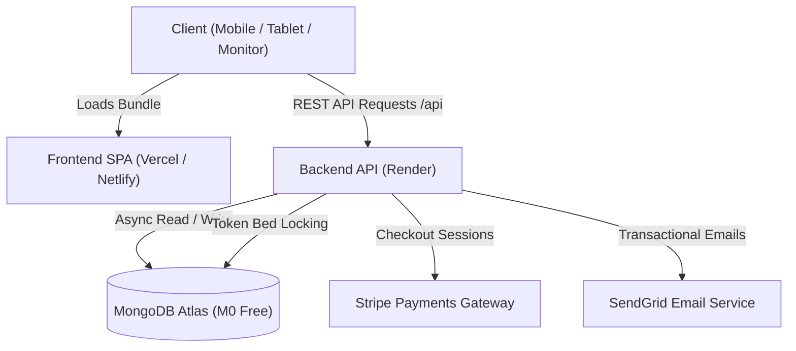

# NextGen PG Booking - Complete Project Structure

This document provides a comprehensive map and breakdown of the entire NextGen PG Booking codebase, covering both the active production Web Stack (FastAPI + React Vite) and the Enterprise Architecture Subsystem (Node.js + PostgreSQL + React Native).

---

## Repository High-Level Directory Tree

```
p/
|-- DEPLOYMENT.md             # 3-Tier Zero-Cost Production Deployment Guide
|-- PROJECT_STRUCTURE.md      # Complete architectural and directory breakdown (This file)
|-- render.yaml               # Render Blueprint (Infrastructure-as-Code for Backend API)
|-- p.md                      # Architecture specifications, security checklists and requirements
|-- .gitignore                # Root Git ignore rules (node_modules, .env, __pycache__, dist)
|
|-- backend/                  # Production FastAPI Python Web Backend
|   |-- server.py             # Main ASGI application entrypoint and middleware orchestrator
|   |-- requirements.txt      # Python dependencies (FastAPI, Motor, Pydantic, dnspython, etc.)
|   |-- Procfile              # Process manager declaration for Render / cloud hosts
|   |-- .env.example          # Environment variables template
|   |-- test_security_suite.py# Automated security audit and regression test suite
|   |-- uploads/              # Local storage directory for KYC / property images (.gitkeep)
|   `-- app/                  # Application core packages
|       |-- config.py         # App configuration and environment loader with CORS parsing
|       |-- database.py       # MongoDB Motor async driver + in-memory fallback store and seed
|       |-- ratelimit.py      # IP and account-based rate limiter (anti-brute-force)
|       |-- routes/           # Domain API endpoint routers (/api prefix)
|       |   |-- ai.py         # AI PG Finder route (budget and college prompt matcher)
|       |   |-- auth.py       # JWT authentication, registration, login and password recovery
|       |   |-- bookings.py   # 10-minute real-time bed lock, reservations and cancellations
|       |   |-- payments.py   # Stripe checkout session creation and webhook handler
|       |   |-- properties.py # PG search, city filters, owner listings and boosting
|       |   |-- seo.py        # Dynamic sitemap.xml and robots.txt generation
|       |   `-- uploads.py    # MIME and magic-byte verified file upload pipeline
|       `-- utils/            # Shared security and communication utilities
|           |-- email.py      # SendGrid transactional email client (receipts and password reset)
|           `-- security.py   # Password hashing (bcrypt) and JWT token encoding/decoding
|
|-- frontend/                 # Production React 18 + Vite Single Page Application
|   |-- index.html            # Main HTML document with SEO meta tags and font preloads
|   |-- package.json          # Node dependencies and build scripts (Vite, Lucide React, Router)
|   |-- vite.config.js        # Vite dev server and reverse-proxy config (:3000 -> :8001)
|   |-- vercel.json           # Vercel SPA client-side routing rewrites
|   |-- netlify.toml          # Netlify build configuration and redirect rules
|   |-- public/               # Static assets and web crawler configuration
|   |   `-- _redirects        # Netlify SPA routing fallback (/* -> /index.html 200)
|   `-- src/                  # React application source code
|       |-- main.jsx          # React DOM root entrypoint
|       |-- App.jsx           # React Router setup and global modal orchestrator
|       |-- index.css         # Complete design system and Auto-Adaptive responsive CSS
|       |-- api.js            # Unified Fetch client library with JWT header injection
|       |-- context/          # Global application state providers
|       |   `-- AuthContext.jsx # User auth state, login/register/logout and token sync
|       |-- components/       # Reusable UI components
|       |   |-- Navbar.jsx    # Auto-adaptive top header with mobile hamburger drawer
|       |   |-- PropertyCard.jsx # PG listing card with badges, amenities and prices
|       |   |-- AuthModal.jsx # Unified Modal for Login, Registration and Forgot Password
|       |   `-- AiAssistantModal.jsx # Interactive AI accommodation assistant modal
|       |-- pages/            # Application view pages
|       |   |-- HomePage.jsx  # Hero search, city hub cards, verified PG listings and guarantees
|       |   |-- PropertyDetail.jsx # Gallery, room/bed matrix, sticky booking bar and schema
|       |   |-- CityLandingPage.jsx # City-specific landing page (Jaipur, Neemrana, Behror, Kotputli)
|       |   |-- OwnerDashboard.jsx # Property creation, bed occupancy and 30-day listing boost
|       |   |-- TenantDashboard.jsx # Active booking history, token receipts and cancellation
|       |   `-- BookingSuccess.jsx # Post-payment confirmation and reservation voucher
|       `-- lib/              # Helper utilities
|           `-- structuredData.js # Safe JSON-LD schema generator for Google rich snippets
|
`-- pgbooking/                # Enterprise Multi-Service and Mobile Ecosystem Subsystem
    |-- README.md             # Enterprise system documentation and quick start
    |-- docker-compose.yml    # Development multi-container orchestration (PostgreSQL, Redis)
    |-- docker-compose.prod.yml # Production multi-container orchestration
    |-- apps/                 # Monorepo application targets
    |   |-- backend/          # Node.js + Express 20 + TypeScript microservices API
    |   `-- mobile/           # React Native 0.74 + TypeScript cross-platform mobile app
    |-- database/             # PostgreSQL 16 + PostGIS schema, migrations and seed scripts
    |-- docs/                 # Architectural specifications, API docs, and testing guides
    `-- infrastructure/       # Nginx reverse proxy, Prometheus, Grafana, and CI/CD pipelines
```

---

## Module Deep-Dive

### 1. Active Web Frontend (frontend/)

Built with React 18, Vite, and Vanilla CSS Design System. Features zero external UI framework bloat while providing rich glassmorphic aesthetics.

| Path | Purpose | Key Responsibilities |
|---|---|---|
| `src/index.css` | Design System | Defines CSS tokens, glassmorphism, responsive grid breakpoints (<640px mobile, 641-1024px tablet, >1024px monitor). |
| `src/api.js` | API Client | Centralized HTTP requests with automatic Bearer token injection and sanitized backend URLs. |
| `src/context/AuthContext.jsx` | Auth State | Manages logged-in user state, JWT tokens in localStorage, and role permissions (tenant vs owner). |
| `src/components/Navbar.jsx` | Navigation | Sticky adaptive header with responsive mobile hamburger drawer, city links, and quick AI PG Finder. |
| `src/pages/HomePage.jsx` | Main Discovery | Real-time search with city and gender filter pills, top cities showcase, and listing cards. |
| `src/pages/PropertyDetail.jsx` | PG Reservation | Auto-adaptive photo gallery, live bed locking matrix, rent breakdown, and mobile sticky booking bar. |
| `src/pages/OwnerDashboard.jsx` | Host Portal | Manage properties, inspect real-time bed occupancy, add new rooms, and activate 30-day listing boosts. |
| `src/pages/TenantDashboard.jsx` | Resident Portal | View confirmed bookings, view check-in schedules, download receipts, and trigger refund cancellations. |

---

### 2. Active Web Backend (backend/)

Built with FastAPI, Motor (Async MongoDB), and Pydantic v2. Provides high-concurrency async endpoints with comprehensive security middleware.

| Path | Component | Description |
|---|---|---|
| `server.py` | ASGI Application | Configures CORS, security headers (nosniff, DENY), mounts /api routes, and serves /uploads. |
| `app/config.py` | Configuration | Manages environment settings, parses comma-separated CORS_ORIGINS, and sets defaults. |
| `app/database.py` | Database Layer | Asynchronous MongoDB connection using Motor with automatic in-memory fallback for local testing. |
| `app/ratelimit.py` | Rate Limiter | In-memory token bucket rate limiting on sensitive routes (/auth/login, /auth/forgot-password). |
| `app/routes/auth.py` | Auth Endpoints | Registration, password hashing, JWT issue/validation, forgot password, and /auth/me. |
| `app/routes/bookings.py` | Booking Logic | 10-minute atomic bed lock mechanism, token payment confirmation, and refund policy calculations. |
| `app/routes/properties.py` | PG Catalog | Query verified properties by city/gender/sharing, create listings, and purchase listing boosts. |
| `app/routes/uploads.py` | File Storage | Secure multi-part upload pipeline enforcing 5MB cap, UUID naming, and image magic-byte verification. |

---

### 3. Enterprise Subsystem (pgbooking/)

An enterprise-grade reference architecture for multi-region scale:

- Mobile App (apps/mobile/): React Native 0.74 with Redux Toolkit, React Navigation, and Axios interceptors.
- Node Backend (apps/backend/): Express + TypeScript microservices with BullMQ task queues and Redis locking.
- Database (database/): 9 sequential SQL migrations featuring PostGIS spatial coordinates and RS256 auth tables.
- Infrastructure (infrastructure/): Nginx SSL termination, Prometheus metrics, Grafana dashboards, and AWS S3 automation.

---

## Data Flow and System Interactions



---

## Environment Variables Cross-Reference

| Variable | Scope | Purpose |
|---|---|---|
| `MONGO_URL` | Backend | MongoDB Atlas SRV connection string (mongodb+srv://...) |
| `DB_NAME` | Backend | Database name (Default: pgbooking) |
| `JWT_SECRET` | Backend | Secret key used to sign and verify HS256 auth tokens |
| `FRONTEND_URL` | Backend | Target frontend URL for CORS validation |
| `CORS_ORIGINS` | Backend | Comma-separated list of allowed origins or domains |
| `VITE_BACKEND_URL` | Frontend | Render API URL (e.g. https://pgbooking-api.onrender.com) |
| `STRIPE_API_KEY` | Backend | Stripe secret key for real-time payments |
| `SENDGRID_API_KEY` | Backend | SendGrid key for transactional receipts and alerts |

---

## Tech Stack Summary

| Layer | Technologies Used |
|---|---|
| **Web Frontend** | React 18, Vite, React Router 6, Lucide React, Vanilla CSS3 (Glassmorphism) |
| **Web Backend** | Python 3.11+, FastAPI, Motor, Pydantic v2, Uvicorn, Python-Jose, Bcrypt |
| **Database** | MongoDB Atlas (Free Tier M0) / Motor Async Driver |
| **Payment Gateway** | Stripe (Checkout Sessions and Webhook processing) |
| **Email Gateway** | SendGrid API (Transactional email notifications) |
| **Cloud Hosting** | Render (Web Service Backend) + Vercel or Netlify (Frontend SPA) |
| **Mobile and Enterprise** | React Native 0.74, Express.js, TypeScript, PostgreSQL 16 + PostGIS, Redis 7, BullMQ |
